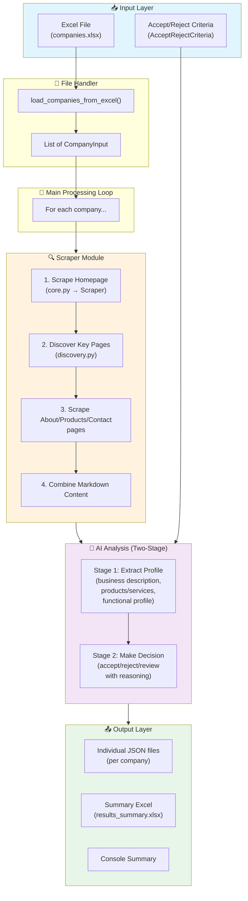
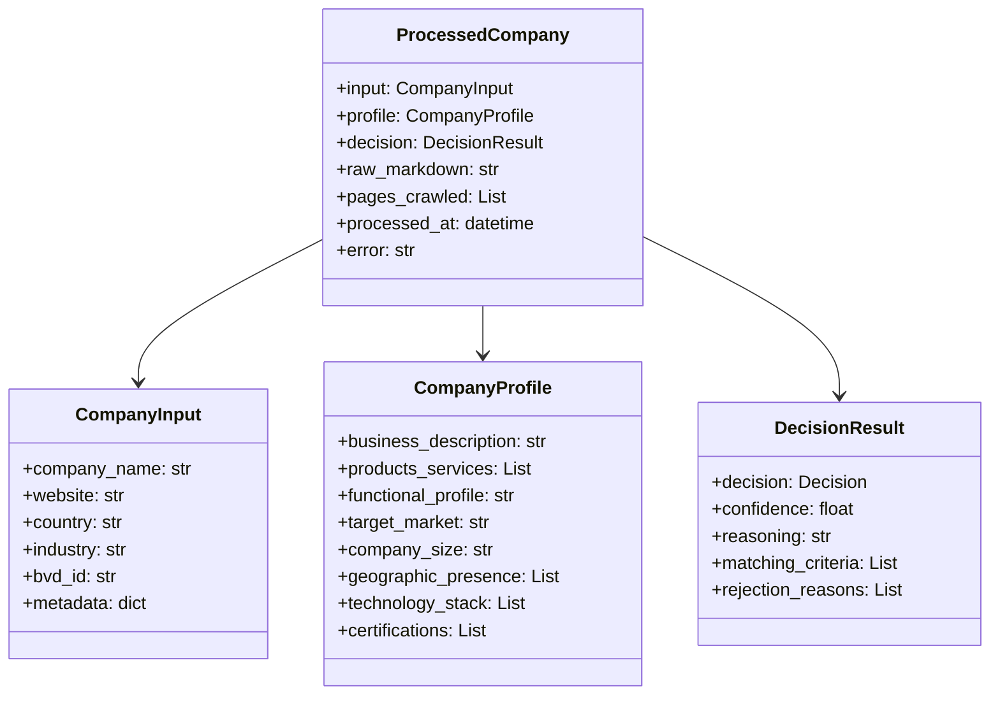

# AI Scraper Project Walkthrough

A comprehensive guide to understanding the AI-powered company analysis pipeline.

---

## Project Overview

This application processes company data from Excel files, scrapes company websites, uses AI to extract structured business information, and makes **accept/reject recommendations** based on configurable criteria.

---

## Architecture Flow Diagram



---

## Module Breakdown

### 1. Entry Point: [main.py](file:///home/chaitanya/Desktop/Development/learning/python-learnings/AIScraperExtractorProject/ai-scraper/main.py)

The orchestrator that ties everything together:

| Step | Action | Code Location |
|------|--------|---------------|
| 1 | Load companies from Excel | `load_companies_from_excel()` |
| 2 | Initialize Scraper & AI | `Scraper()`, `AIAnalyzer()` |
| 3 | Define Accept/Reject criteria | `AcceptRejectCriteria()` |
| 4 | Process each company | `process_company()` loop |
| 5 | Save results | `save_result_json()`, `export_summary_excel()` |

---

### 2. Data Models: [models.py](file:///home/chaitanya/Desktop/Development/learning/python-learnings/AIScraperExtractorProject/ai-scraper/models.py)



---

### 3. Scraper Module: [scraper/](file:///home/chaitanya/Desktop/Development/learning/python-learnings/AIScraperExtractorProject/ai-scraper/scraper)

| File | Purpose |
|------|---------|
| [core.py](file:///home/chaitanya/Desktop/Development/learning/python-learnings/AIScraperExtractorProject/ai-scraper/scraper/core.py) | `Scraper` class - uses **crawl4ai** to fetch webpage content as markdown |
| [discovery.py](file:///home/chaitanya/Desktop/Development/learning/python-learnings/AIScraperExtractorProject/ai-scraper/scraper/discovery.py) | Finds key pages (about, products, contact) from homepage links |
| [ai.py](file:///home/chaitanya/Desktop/Development/learning/python-learnings/AIScraperExtractorProject/ai-scraper/scraper/ai.py) | `AIAnalyzer` class - uses **Groq API** (LLaMA 3) for AI analysis |

#### How Scraping Works:
```
Homepage → Extract Links → Find /about, /products, /contact → Scrape Each → Combine as Markdown
```

---

### 4. Pipeline Module: [pipeline/](file:///home/chaitanya/Desktop/Development/learning/python-learnings/AIScraperExtractorProject/ai-scraper/pipeline)

| File | Purpose |
|------|---------|
| [criteria.py](file:///home/chaitanya/Desktop/Development/learning/python-learnings/AIScraperExtractorProject/ai-scraper/pipeline/criteria.py) | `AcceptRejectCriteria` - defines what makes a company acceptable/rejectable |
| [processor.py](file:///home/chaitanya/Desktop/Development/learning/python-learnings/AIScraperExtractorProject/ai-scraper/pipeline/processor.py) | Two-stage AI analysis (extract profile → make decision) |
| [file_handler.py](file:///home/chaitanya/Desktop/Development/learning/python-learnings/AIScraperExtractorProject/ai-scraper/pipeline/file_handler.py) | Excel loading, JSON saving, summary export |

---

## Accept/Reject Strategy

The criteria is configurable in [criteria.py](file:///home/chaitanya/Desktop/Development/learning/python-learnings/AIScraperExtractorProject/ai-scraper/pipeline/criteria.py):

| Type | Examples |
|------|----------|
| ✅ **Accept Industries** | Technology, Healthcare, Financial Services, Software |
| ✅ **Accept Keywords** | SaaS, platform, cloud, API, analytics |
| ❌ **Reject Keywords** | gambling, casino, tobacco, weapons |
| ❌ **Reject Industries** | Gambling, Tobacco, Adult Entertainment |

> [!NOTE]
> **Reject criteria override accept criteria** - if a company matches both, it will be rejected.

---

## What's Currently MISSING

Based on your use case, here are gaps in the current implementation:

| Feature | Status | What's Needed |
|---------|--------|---------------|
| **Database Storage** | ❌ Missing | No DB integration - results only saved as JSON/Excel files |
| **Web UI for Excel Upload** | ❌ Missing | Currently runs via command line only |
| **Criteria Configuration UI** | ❌ Missing | Accept/reject rules are hardcoded |
| **Comparison Study Dashboard** | ❌ Missing | No UI to compare companies side-by-side |
| **Real-time Progress Tracking** | ❌ Missing | Only console output during processing |
| **Error Recovery / Resume** | ⚠️ Partial | No way to resume if interrupted mid-batch |

---

## Recommended Next Steps

To complete your use case, consider adding:

1. **Database Layer** - SQLite or PostgreSQL to store:
   - Uploaded Excel data (`CompanyInput`)
   - Extracted profiles (`CompanyProfile`)
   - Decisions with reasoning (`DecisionResult`)

2. **Web Application** (Flask/FastAPI) with:
   - Excel file upload endpoint
   - Criteria configuration page
   - Progress tracking during batch processing
   - Results dashboard with filtering

3. **Comparison View** - Side-by-side company profiles for comparable study

4. **Batch Processing Queue** - Handle large files asynchronously with progress updates

---

## How to Run Currently

```bash
# 1. Install dependencies
cd ai-scraper
pip install -r requirements.txt

# 2. Set up GROQ API key
echo "GROQ_API_KEY=your_key_here" > .env

# 3. Place your Excel file as companies.xlsx

# 4. Run
python main.py
```

Results will be saved to the `output/` folder.
